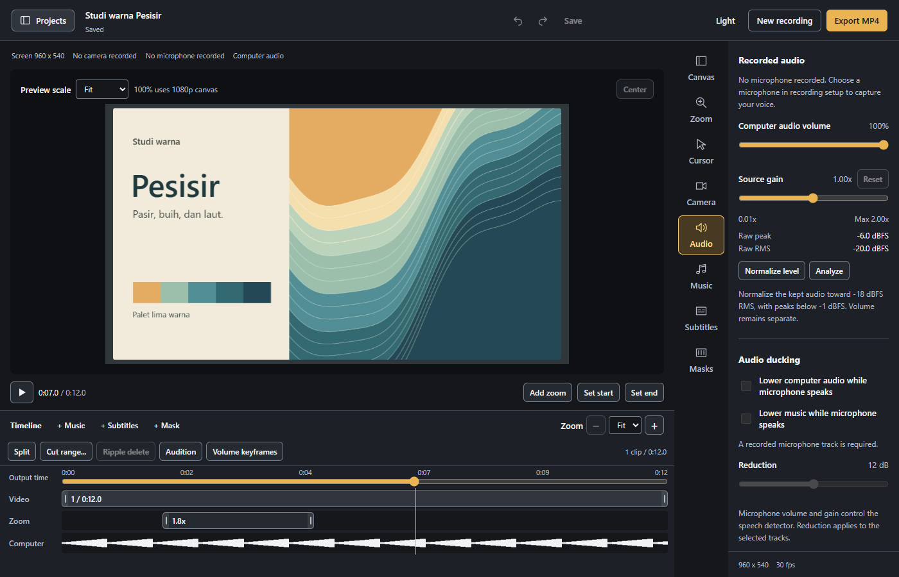

# Screenrecord

Screenrecord adalah perekam layar dan editor video untuk Windows 11 x64. Setelah merekam, Anda bisa mengecilkan suara komputer tanpa mengubah volume mikrofon, memindahkan tampilan webcam, atau mengatur zoom pada bagian yang ingin ditunjukkan. Proyek menyimpan sumber rekaman dan hasil edit secara terpisah.

[Unduh Screenrecord untuk Windows](https://screenrecord.88apps.dev) · [Rilis GitHub](https://github.com/real-habibul/screenrecord/releases/latest)



## Instalasi

Unduh installer x64 dari situs Screenrecord, lalu jalankan berkas `Screenrecord_0.7.4_x64-setup.exe`. Installer memasang aplikasi untuk akun Windows Anda. Jika Microsoft Edge WebView2 Runtime belum tersedia, installer akan mengunduhnya.

**Installer 0.7.4 belum memiliki tanda tangan digital.** Windows dapat menampilkan peringatan penerbit tidak dikenal. Untuk mencocokkan berkas unduhan dengan nilai SHA-256 yang disertakan dalam rilis, jalankan perintah berikut dari folder unduhan.

```powershell
Get-FileHash .\Screenrecord_0.7.4_x64-setup.exe -Algorithm SHA256
```

## Merekam, mengedit, dan mengekspor

1. Klik **New recording**. Pilih layar, jendela, atau area yang ingin direkam, lalu pilih mikrofon, audio komputer, dan webcam sesuai kebutuhan. **Test 5 seconds** membantu memeriksa hasil sebelum merekam.
2. Klik **Start recording**. Gunakan **Pause** dan **Resume** untuk menjeda dan melanjutkan rekaman. Klik **Stop** untuk membuka hasilnya di editor.
3. Putar rekaman dan potong bagian yang tidak diperlukan di timeline. Buka **Audio** untuk mengatur volume tiap sumber atau **Camera** untuk mengubah ukuran dan posisi webcam. Anda juga bisa menambah zoom, musik, subtitle, dan area blur.
4. Klik **Export MP4**. Pilih **Standard** untuk mengatur resolusi atau **WhatsApp** untuk membuat berkas kecil. Klik **Browse**, pilih nama berkas baru, lalu klik **Export video**.

Anda bisa melanjutkan edit lewat **Projects**. Untuk mencadangkan proyek yang masih akan diedit, salin seluruh folder proyek. Secara bawaan, lokasinya ada di `Videos\Screenrecord` dalam profil Windows Anda. [Panduan editor audio dan timeline](docs/EDITOR-0.7.0.md)

## Privasi

Screenrecord menyimpan rekaman dan memproses ekspor di komputer Anda, tanpa telemetri. Untuk membuat subtitle lokal, unduh model dan alat transkripsi lewat editor. Setelah unduhan selesai, transkripsi dapat berjalan luring.

Jika Anda memilih **Cloud (Deepgram)**, memasukkan kunci API sendiri, dan menekan **Upload audio and generate**, aplikasi mengirimkan audio pilihan dari bagian rekaman yang dipertahankan ke Deepgram. Kunci hanya digunakan untuk permintaan tersebut. Biaya pemakaian mengikuti akun Deepgram Anda.

## Kontribusi dan lisensi

Anda bisa melaporkan bug, mengusulkan fitur, atau mengirim perbaikan kode dan dokumentasi. Panduan kontribusi menjelaskan cara membangun aplikasi dan menjalankan pengujian. [Buka issue](https://github.com/real-habibul/screenrecord/issues) · [Panduan kontribusi](CONTRIBUTING.md)

Kode Screenrecord menggunakan lisensi MIT. FFmpeg dan komponen lain yang dibundel memiliki lisensi masing-masing. [Lisensi MIT](LICENSE) · [Komponen pihak ketiga](THIRD_PARTY_NOTICES.md)
